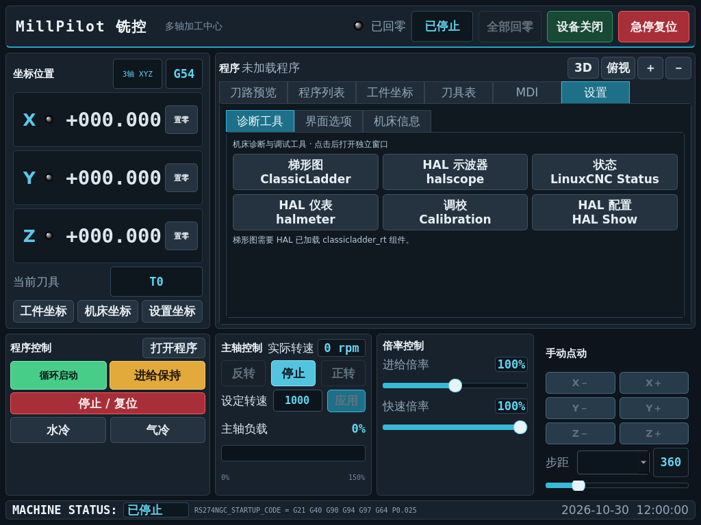

# MillPilot 铣控

**面向 3–5 轴铣床的中文 LinuxCNC QtVCP 触摸界面，适配 1024×768。**

使用 LinuxCNC 原生 QtVCP，不依赖 Probe Basic / QtPyVCP。适合在已经能够正常运行的 LinuxCNC 机床配置上更换操作界面。



*截图为离线渲染的界面预览，不代表机床正在运行。*

## 快速安装

先安装并配置好 LinuxCNC，确认原界面下机床配置能够启动。关闭 LinuxCNC 后，在终端执行：

```bash
git clone https://github.com/84864797/MillPilot.git
cd MillPilot

# 将 my_machine/my_machine.ini 替换为自己的机床 INI 路径
python3 scripts/install.py ~/linuxcnc/configs/my_machine/my_machine.ini --dry-run
python3 scripts/install.py ~/linuxcnc/configs/my_machine/my_machine.ini
```

安装脚本会完整备份原机床目录，安装界面，修改 `[DISPLAY] DISPLAY`，转换点动步距格式，并迁移标准 gmoccapy 手动换刀引脚。原来的轴参数、回零方向、运动学和硬件配置继续沿用。若原配置没有任何换刀逻辑且需要手动换刀，可在安装命令加 `--manual-toolchange`；已有自动换刀配置不要加此参数。

然后使用**原来的机床 INI 文件**启动 LinuxCNC：

```bash
linuxcnc ~/linuxcnc/configs/my_machine/my_machine.ini
```

ZIP 用户：在 GitHub 点击 **Code → Download ZIP**，解压后进入目录，执行相同的安装命令即可。无需安装 Git，也无需 `sudo`。

**完整说明：[安装、换刀接入、更新与回退](docs/INSTALL.md) · [操作指南](docs/USAGE.md) · [常见问题](docs/TROUBLESHOOTING.md)**

## 功能

- 根据 INI 配置显示 3–5 轴坐标、回零状态、工件坐标置零和点动按钮。
- OpenGL 刀路预览、3D / 俯视、缩放、程序列表和 MDI。
- 工件坐标与刀具补偿表，配套深色计算器和文字键盘。
- 主轴反转 / 停止 / 正转，直接输入设定转速，控制器状态高亮。
- 循环启动、暂停、停止、进给与快速倍率、水冷和气冷。
- 全部回零与 Home 快捷键共用规则；回零顺序服从 INI，已回零后再次点击不会切换为取消回零。
- 设置页：梯形图、HAL 示波器、状态、HAL 仪表、调校、HAL 配置；界面选项自动保存。
- 底部显示机床状态、可选 INI 启动代码和时钟。

## 使用要求与当前范围

| 项目 | 说明 |
| --- | --- |
| 运行环境 | LinuxCNC 2.9 系列、QtVCP、Python 3、PyQt5 / QtPy、可用的 OpenGL 环境 |
| 目标分辨率 | 固定 1024×768；更高分辨率屏幕可使用全屏显示，内容仍按此尺寸布局 |
| 核对版本 | 本项目使用 LinuxCNC 2.9.8 的本机接口核对及离线 UI / 回调测试 |
| 验证范围 | 不是经过所有机型验证的整机配置；5 轴仅提供界面轴映射，不提供运动学方案 |
| 实际转速 / 负载 | 必须有真实 HAL 反馈源；界面不会根据设定值伪造反馈 |
| 梯形图 | 机床 HAL 必须已经加载 `classicladder_rt` |
| 探针 / 自动对刀 | 当前基础界面不提供；相关上游宏仅放在 `extras/` 供开发参考 |

首次更换界面请先保持急停，确认显示、引脚、轴名与原配置一致，再低速逐项测试。不要用示例替换整份机床 INI 或硬件 HAL。

## 目录

```text
qtvcp/screens/cnc_3axis_1024/   实际屏幕文件
examples/                     INI 和 post-GUI HAL 接入示例
scripts/install.py            带完整备份的安装/更新脚本
scripts/build_package.py      生成可分发的 ZIP 安装包
docs/                         安装、操作、排错说明与截图
tests/                        安装器与界面检查
extras/probe-basic/            未接入界面的实验探测宏及原许可证
```

界面的正式名称为 **MillPilot 铣控**。内部屏幕标识保留 `cnc_3axis_1024`，用于兼容已有配置；不要单独重命名 `.ui`、handler 或屏幕目录。

## 开发与检查

```bash
python3 -m unittest discover -s tests -v
# 在装有 LinuxCNC / QtVCP 的桌面环境中运行离线界面检查：
QT_QPA_PLATFORM=offscreen /usr/bin/python3 tests/check_runtime.py
python3 scripts/build_package.py
```

普通测试不启动 LinuxCNC、不操作硬件；运行时检查使用真实 QtVCP 控件和模拟控制器状态，机器命令被替换。发布前仍需在目标机床配置中检查启动和实际 I/O。

## 许可与致谢

项目按 [GNU GPL v3](LICENSE) 分发。实验宏保留 Probe Basic 原作者注释与许可证，详见 [第三方说明](THIRD_PARTY_NOTICES.md)。操作分区参考 gmoccapy、Probe Basic 的使用习惯，MillPilot 使用独立的 QtVCP 实现。

参考：[LinuxCNC QtVCP](https://linuxcnc.org/docs/stable/html/gui/qtvcp.html) · [QtVCP 控件](https://linuxcnc.org/docs/stable/html/gui/qtvcp-widgets.html) · [Probe Basic](https://github.com/kcjengr/probe_basic)
